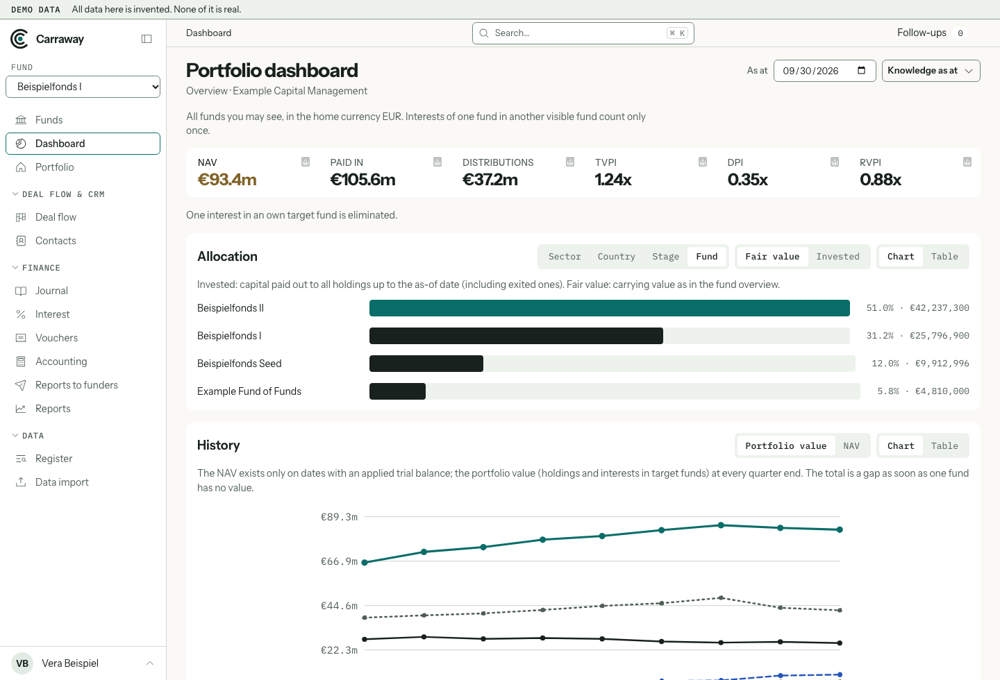
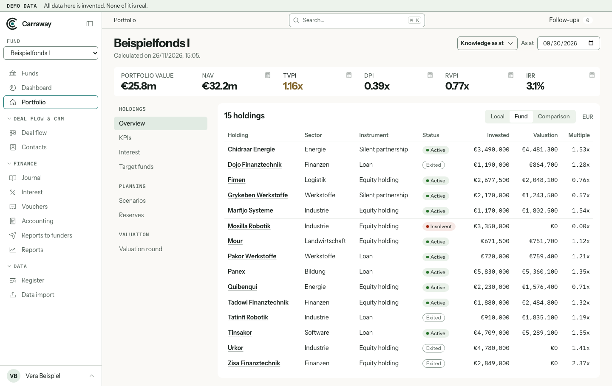
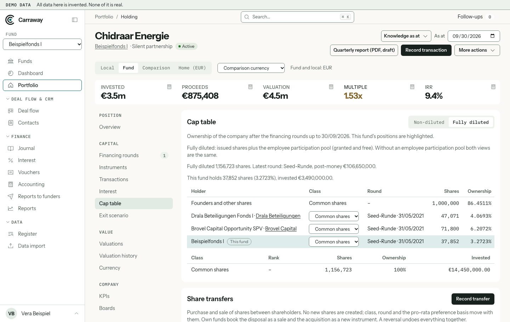
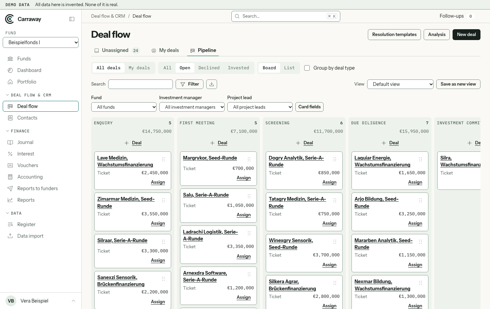

# Carraway

Carraway is an open-source, self-hosted platform for venture capital and private equity firms to manage deal flow, administer funds, and track portfolios.

[](https://github.com/carraway-app/carraway/actions/workflows/ci.yml)
[](LICENSE)
[](https://github.com/carraway-app/carraway/pkgs/container/carraway)

[Quick start](#quick-start) · [Features](#features) · [Documentation](#documentation) · [Contributing](#contributing)



<details>
<summary>More screenshots with fictional demo data</summary>







</details>

## Features

- **Deal flow and CRM.** Track deals on a board or in a list, manage companies and contacts, and organize records with custom fields, lists, and saved views.
- **Funds and capital.** Record commitments, closings, capital calls, and distributions. Track LP capital accounts with allocated management fees and fund expenses.
- **Portfolio and ownership.** Track equity, convertible loans, SAFEs, warrants, and share transfers. View fully diluted cap tables and model exit proceeds with liquidation waterfalls.
- **Valuations and performance.** Trace NAV, IRR, and multiples back to their inputs and calculation steps. Choose a reporting date and a separate knowledge cutoff to see what was known at the time. Track underlying funds and their cash flows in a fund-of-funds portfolio.
- **Reporting and records.** Route reports through approval and export them as PDF or Excel. Prepare regulatory and funding reports, export accounting entries, and retain document versions.
- **Access and audit.** Set roles and permissions per fund, use two-factor authentication, and review the audit log. The interface and reports are available in English and German.
- **Integration and portability.** Use the English-language HTTP API with OpenAPI, signed webhooks, and live updates over WebSocket. Download a full data export with open formats, calculation rules, and a checksum manifest.

## Quick start

The released image supports **linux/amd64** only. You need Docker with Compose 2.20 or later. To start a local instance, clone the repository and copy the Compose environment file.

```sh
git clone https://github.com/carraway-app/carraway.git carraway
cd carraway/deploy
cp .env.example .env
```

Edit `.env` and set the following values.

| Setting | Value for a local instance |
| --- | --- |
| `CARRAWAY_ENVIRONMENT` | `test` |
| `APP_ORIGIN` | `http://localhost:8787` |
| `BETTER_AUTH_SECRET` | A random value from `openssl rand -base64 48` |
| `DB_ADMIN_PASSWORD`, `DB_OWNER_PASSWORD`, `DB_APP_PASSWORD` | A separate random value from `openssl rand -hex 24` for each |

The Compose file selects the image for this release. Set `CARRAWAY_IMAGE` only to override it.

```sh
docker compose pull
docker compose up -d --no-build
docker compose ps --all
```

When `carraway-migrate` has exited with code 0 and the API is healthy, open [the local setup page](http://localhost:8787/setup) and enter the token from the latest `Carraway /setup token:` line in `docker compose logs carraway` to create the first administrator. For a source build, run `docker compose -f docker-compose.yml -f docker-compose.build.yml up -d --build`.

For a public deployment, follow the TLS and reverse proxy instructions in the [self-hosting guide](deploy/README.en.md).

## Architecture

A React frontend and a Hono HTTP API share one origin in a Compose deployment. PostgreSQL stores application data and backs the job queue. A separate worker runs background jobs, including performance snapshot calculations. The API, worker, and one-shot migration service use the same image. The shared TypeScript calculation engine lives in [`packages/rechenkern`](packages/rechenkern/).

## Open core

This repository contains the AGPL-3.0 core for self-hosting, including the workflows listed above. Some extensions are available exclusively through Rehlytics managed hosting, including the LP portal, the Excel add-in, ESG and SFDR workflows, single sign-on, and AI-assisted document processing. [Carraway website](https://carraway.vc) · [Open-core architecture](docs/open-core.md)

## Documentation

- [Self-hosting, configuration, backups, and upgrades](deploy/README.en.md)
- [Portfolio model, instruments, and calculations](docs/portfolio-model.md)
- [Fund permissions and roles](docs/permissions-model.md)
- [Webhooks and live updates](docs/webhooks-and-live.md)
- OpenAPI reference on your instance at `/api/v1/docs` and the schema at `/api/v1/openapi.json`.

## Contributing

See [Contributing](CONTRIBUTING.md) for local development, tests, and pull requests. Use the private reporting channels in the [security policy](SECURITY.md) for vulnerabilities.

## Contact

Questions about Carraway or managed hosting: [hello@carraway.vc](mailto:hello@carraway.vc). Report security issues as described in the [security policy](SECURITY.md).

## License

Carraway's core is licensed under the [GNU Affero General Public License v3.0](LICENSE).
